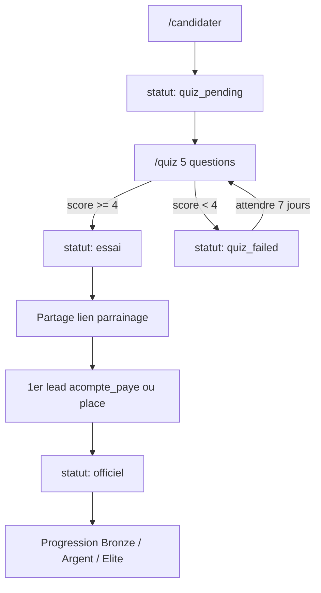

# Spec globale — KPB Education (Programme Ambassadeur)

**Document de référence produit / technique**  
**Version :** 1.0 (brouillon aligné sur le code au 2026-07-27)  
**Stack :** TanStack Start · React 19 · Supabase · Tailwind 4 · Bun  

Ce document décrit le site tel qu’il fonctionne aujourd’hui, plus les évolutions prévues (signature de contrat).

---

## 1. Vision produit

### 1.1 Problème

KPB Education accompagne des étudiants africains et internationaux vers des écoles partenaires à l’étranger. Pour scaler l’acquisition, KPB s’appuie sur un réseau d’**ambassadeurs** (souvent pairs / étudiants) qui parrainent des candidats.

### 1.2 Solution

Une plateforme web qui permet de :

1. **Recruter** des ambassadeurs (candidature + quiz).
2. Leur donner un **lien de parrainage** et un kit marketing.
3. **Collecter** les leads étudiants et les **répartir** entre commerciaux (round-robin).
4. **Suivre** le pipeline commercial jusqu’au placement.
5. **Calculer et payer** commissions + bonus paliers de façon transparente.

### 1.3 Marque

| Élément | Valeur |
|---------|--------|
| Nom produit | **KPB Education** — Programme Ambassadeur |
| Entité juridique (contrat) | **KPB Global L.L.C.** |
| Promesse | Aucun investissement · commissions 10–15 % · suivi transparent |
| Destinations | France, Allemagne, Espagne, Maroc, Turquie, Canada, Dubaï, USA |

---

## 2. Utilisateurs & rôles

### 2.1 Rôles

| Rôle | Qui | Espace principal |
|------|-----|------------------|
| `agent` | Ambassadeur / parrain | `/dashboard` |
| `commercial` | Conseiller KPB | `/commercial` |
| `admin` | Direction / ops | `/admin` (+ `/commercial`) |

### 2.2 Permissions (résumé)

| Capacité | Agent | Commercial | Admin |
|----------|:-----:|:----------:|:-----:|
| Passer le quiz / gérer son lien | Oui | — | — |
| Voir ses leads & commissions | Oui (siens) | — | Oui (tous) |
| Voir / traiter les leads assignés | — | Oui | Oui |
| Inviter un agent | — | Oui | Oui |
| Marquer commissions payées | — | — | Oui |
| Gérer pool round-robin | — | — | Oui |
| Changer les rôles utilisateurs | — | — | Oui |

**Sécurité :** gardes de route (`beforeLoad`) + **RLS Postgres**. Les contrôles UI ne suffisent jamais seuls.

---

## 3. Cartographie des pages

### 3.1 Public

| Route | Rôle |
|-------|------|
| `/` | Landing marketing. Si `?ref=CODE` → stocke le code → `/rejoindre` |
| `/candidater` | Inscription ambassadeur |
| `/rejoindre` | Formulaire lead étudiant (nécessite code de parrainage) |
| `/login` | Connexion (+ `?redirect=` optionnel) |
| `/mot-de-passe-oublie` | Demande de reset |
| `/reinitialiser-mot-de-passe` | Nouveau mot de passe / acceptation d’invitation |
| `/confidentialite` | Politique de confidentialité |

### 3.2 Authentifié

| Route | Accès | Rôle |
|-------|-------|------|
| `/quiz` | Agent (quiz pending/failed) | Quiz de qualification (5 questions) |
| `/resultat` | Agent | Résultat du quiz |
| `/dashboard` | Agent (essai / officiel) | Tableau de bord ambassadeur |
| `/commercial` | Commercial + Admin | CRM leads + invitation agents |
| `/admin` | Admin | Pilotage global |

---

## 4. Parcours utilisateur

### 4.1 Ambassadeur (happy path)



**États agent (`agents.statut`) :**

| Statut | Signification |
|--------|----------------|
| `quiz_pending` | Inscrit, quiz non réussi |
| `quiz_failed` | Échec ; retry après `quiz_retry_at` (+7 jours) |
| `essai` | Quiz OK ; lien + kit débloqués |
| `officiel` | ≥ 1 placement validé |

**Règle quiz :** 5 questions, score minimum **4/5**. Les bonnes réponses ne sont **pas** exposées au client ; scoring serveur via `submit_quiz_attempt`.

### 4.2 Lead étudiant (filleul)

1. Clique sur le lien ambassadeur : `/rejoindre?ref=KPB-XXX-YYYYYY`
2. Remplit : nom, WhatsApp, email (opt.), pays, destination, message, consentement
3. RPC `submit_referral_lead` crée le lead et assigne un commercial (round-robin)
4. Un conseiller KPB recontacte (WhatsApp / email)

**Anti-abus :** honeypot + rate-limit (5 soumissions / contact / 10 min ; 30 / agent / heure).

### 4.3 Commercial

1. Connexion → `/commercial`
2. Voit ses leads (filtre statut / recherche)
3. Met à jour : statut, montant de service, notes
4. Peut inviter un nouvel agent (email Supabase Invite)
5. (Dev + admin) peut simuler un lead

### 4.4 Admin

1. Connexion → `/admin`
2. KPI agents / leads / commissions
3. Marque les commissions `paid`
4. Gère le pool round-robin (`rr_state`)
5. Change les rôles utilisateurs
6. Accès plein à l’espace commercial

### 4.5 Auth & invitation

| Flux | Détail |
|------|--------|
| Signup | `signUp` + metadata → trigger `handle_new_user` (profile + agent) |
| Login | Redirection selon rôle ou `?redirect=` |
| Reset MDP | Email → `/reinitialiser-mot-de-passe` |
| Invite | Server fn `inviteAgent` (service role) → email → set password |

Mot de passe minimum : **8 caractères**.

---

## 5. Modèle économique

### 5.1 Quand une commission est due

Un **placement validé** (dans le produit actuel) correspond à un lead au statut :

- `acompte_paye` **ou** `place`

**et** un `montant_service` > 0 renseigné par le commercial.

*(Le contrat métier précise : admission école partenaire + paiement des frais via KPB — à aligner explicitement côté process commercial.)*

### 5.2 Paliers & taux

| Palier | Placements validés | Commission |
|--------|--------------------|------------|
| Bronze | 0 – 2 | **10 %** |
| Argent | 3 – 9 | **12 %** |
| Élite | ≥ 10 | **15 %** |

Base de calcul : `montant_service` × taux. Devise d’affichage / paiement : **FCFA (XOF)**.

### 5.3 Bonus paliers

| Seuil | Bonus |
|-------|-------|
| 3 placements | **20 000 FCFA** |
| 5 placements | **50 000 FCFA** |
| 10 placements | **100 000 FCFA** |

Type commission : `bonus_palier`. Statuts : `pending` → `paid` (admin).

### 5.4 Challenge (non cash)

Période en cours (configurable) : **10 juin → 10 octobre 2026**.  
Top 3 du leaderboard : smartphone/tablette, accessoire, gadget.

### 5.5 Pipeline lead (statuts)

```
nouveau → contacte → qualifie → acompte_paye → place
```

Labels UI : Nouveau / Contacté / Qualifié / Frais payés / Placé.

---

## 6. Round-robin commercial

- Table `rr_state` : liste des commerciaux (`commercial`, `email`, `whatsapp`, `leads_total`)
- À chaque nouveau lead : attribution au commercial avec le **plus bas** `leads_total` (égalité → plus petit `id`)
- Compteur `leads_total` incrémenté
- Admin peut ajouter / éditer / retirer des commerciaux

---

## 7. Modèle de données

### 7.1 Tables principales

**`profiles`** — identité plateforme  
`id`, `email`, `nom`, `role` (`agent` | `commercial` | `admin`), `created_at`

**`agents`** — profil ambassadeur  
`id`, `nom`, `email`, `whatsapp`, `pays`, `niveau_etudes`, `motivation`,  
`statut`, `tier`, `code_parrainage`, `parrain_id`,  
`quiz_score`, `quiz_passed_at`, `quiz_retry_at`, `placements_count`, `created_at`

**`leads`** — filleuls  
`id`, `agent_id`, `assigned_to`, `nom`, `email`, `whatsapp`, `pays`, `destination`,  
`statut`, `montant_service`, `commission_amount`, `notes`, `created_at`, `updated_at`  
(+ `bonus_paid` legacy, déprécié)

**`commissions`**  
`id`, `agent_id`, `lead_id` (nullable pour bonus palier),  
`type` (`placement` | `bonus_palier` | `bonus_dossier` legacy),  
`montant`, `statut` (`pending` | `paid`), `created_at`

**`rr_state`**  
`id`, `commercial`, `rr_index`, `leads_total`, `email`, `whatsapp`

### 7.2 RPC / fonctions clés

| Fonction | Usage |
|----------|--------|
| `submit_quiz_attempt` | Notation quiz serveur |
| `submit_referral_lead` | Création lead public + RR |
| `assign_lead_round_robin` | Réassignation manuelle |
| `get_agent_rank` / `get_leaderboard` | Classement / challenge |
| `list_agents_basic` / `list_rr_state_basic` | UI commercial (PII limité) |
| `list_users_for_admin` / `set_user_role` | Admin |
| `inviteAgent` (server fn TanStack) | Invitation email |

---

## 8. Design system

| Token | Valeur |
|-------|--------|
| Fond | Navy `#070a13` (`navy-950`) |
| Accent | Or `#d9a110` (`gold-500`) |
| Police UI | **DM Sans** |
| Police display | **Fraunces** |
| Toasts | Sonner |
| Icons | Lucide |
| Composants UI | shadcn (sous-ensemble : dialog, input, label, button, sonner) |

Principes UI : thème sombre unique (agent / commercial / admin), peu de cards décoratives, motion sobre (`fade-in-up`, respect `prefers-reduced-motion`).

---

## 9. Stack technique

| Couche | Techno |
|--------|--------|
| Framework | TanStack Start + TanStack Router (file-based) |
| UI | React 19, Tailwind CSS 4 |
| Data client | TanStack Query + Supabase JS |
| Forms | react-hook-form + Zod |
| Backend | Supabase Auth, Postgres, RLS, RPC |
| Package manager | Bun |
| Qualité | ESLint, Prettier, TypeScript, Vitest, GitHub Actions CI |
| Hébergement / éditeur | Lovable (branche connectée) |

Variables d’environnement : voir `.env.example` (`VITE_SUPABASE_*` côté client ; `SUPABASE_SERVICE_ROLE_KEY` serveur uniquement).

---

## 10. Contenu marketing ambassadeur

**Disponible aujourd’hui**

- Lien de parrainage copiable
- 3 scripts WhatsApp prêts à coller

**Prévu / « Bientôt »**

- Visuels Stories / posts réseaux
- Affiche PDF A4

---

## 11. Roadmap produit (proche)

| Priorité | Fonctionnalité | Statut |
|----------|----------------|--------|
| P0 | **Signature électronique du contrat** ambassadeur (post-validation quiz, avant partage actif du lien) | Spec métier en cours — brouillon : `docs/contrat-ambassadeur-kpb-global.md` |
| P1 | Signature / import signature côté admin | À spécifier UX |
| P2 | Assets marketing téléchargeables | Non livré |
| P3 | Templates email d’invitation brandés | Invite Supabase par défaut |

### 11.1 Cible UX signature (à confirmer)

1. Agent réussit le quiz → `essai`
2. Écran **« Signer le contrat »** (blocage du lien de parrainage tant que non signé)
3. Admin a pré-enregistré la signature KPB (import image ou signature tactile)
4. Agent signe (tactile / mobile) → contrat archivé (PDF ou snapshot) + flag `contrat_signe_at`
5. Déblocage du dashboard / lien de parrainage

---

## 12. Critères d’acceptation globaux (référence QA)

- [ ] Inscription agent → quiz → essai avec score ≥ 4
- [ ] Échec quiz → lock 7 jours
- [ ] Lien `?ref=` crée un lead attribué à un commercial
- [ ] Doublon WhatsApp même agent → pas de double lead
- [ ] Passage `acompte_paye`/`place` + montant → commission `pending` au bon taux
- [ ] Atteinte 3 / 5 / 10 → bonus paliers créés une seule fois
- [ ] Commercial ne voit que ses leads ; admin voit tout
- [ ] Invite agent envoie un email et crée le profil à l’acceptation
- [ ] Pages FR (`lang="fr"`), responsive mobile

---

## 13. Documents liés

| Fichier | Contenu |
|---------|---------|
| [`docs/contrat-ambassadeur-kpb-global.md`](contrat-ambassadeur-kpb-global.md) | Brouillon contrat Ambassadeur ↔ KPB Global L.L.C. |
| [`README.md`](../README.md) | Setup local, scripts, rôles |
| [`supabase/seed/README.md`](../supabase/seed/README.md) | Bootstrap admin manuel |
| [`src/lib/utils.ts`](../src/lib/utils.ts) | TIERS, bonus, destinations, période challenge |
| [`src/types/index.ts`](../src/types/index.ts) | Types domaine |

---

*Spec générée à partir du code et des docs du dépôt. À mettre à jour quand la signature de contrat et les champs légaux seront figés.*
